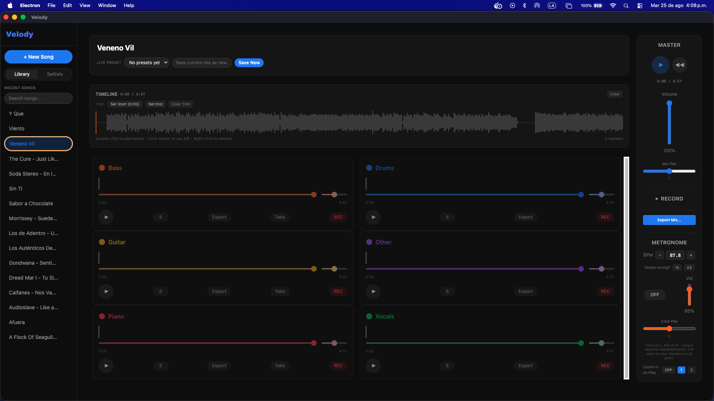

# Velody 🎧

App de escritorio para separar canciones en pistas (voz, batería, bajo, otros) y practicar sobre ellas — 100% local, sin nube.

<table align="center">
  <tr>
    <td align="center">
       
      <b>Reproductor</b>
    </td>
  </tr>
</table>

## Por qué existe

Las herramientas de separación de stems suelen ser un servicio online: subes tu canción, esperas en una cola, y confías en que alguien más no se quede con tu archivo. Velody hace lo mismo pero corriendo enteramente en tu máquina — nada se sube a ningún lado, no hay cuentas, no hay telemetría.

## Features

- 🎚️ Separación de stems (voz, batería, bajo, otros) con Demucs
- 🎧 Reproductor con volumen, pan y mute independiente por stem, sincronizado sample a sample
- 📊 Detección automática de BPM y tonalidad
- 🥁 Metrónomo sincronizado a la canción
- 🎙️ Grabar sobre un stem (por ejemplo, reemplazar la voz con la tuya)
- 🔄 Transposición de tono
- 💾 Exportar stems o la mezcla final

## Cómo está resuelto

- **Todo corre local** — Python (Demucs, FFmpeg) se invoca como subproceso desde Electron, comunicándose por líneas JSON en stdout. No hay backend ni nube involucrados.
- **Mutear un stem baja su ganancia a 0** en vez de detener la fuente de audio — así los stems nunca pierden sincronía entre sí.
- La **detección de BPM combina un modelo de deep learning** (TempoCNN) **con refinamiento por beat-tracking clásico** (librosa) para mayor precisión.

## Stack

Electron · React · TypeScript · Python (Demucs, FFmpeg, librosa, TensorFlow)

## Licencia

MIT — ver [LICENSE](LICENSE)
